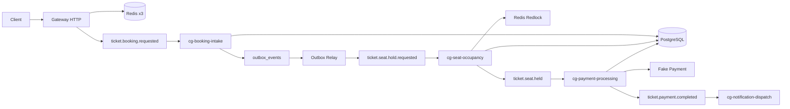

# ticket-stream-kafka

Apache Kafka와 Redis Redlock으로 순간 트래픽을 흡수하고, 같은 좌석의 초과 판매를 막는 NestJS 티켓팅 백엔드입니다.

게이트웨이는 예매 요청을 데이터베이스에 바로 쓰지 않습니다. 요청은 Kafka 토픽에 쌓이고, 접수·좌석 점유·결제·알림 컨슈머 그룹이 각자 처리합니다. 좌석을 바꾸는 구간은 Redlock으로 진입을 줄인 뒤 PostgreSQL `SELECT FOR UPDATE`로 최종 확정합니다. 결제는 `FakePaymentProvider`만 사용하므로 부하 테스트에 PG 비용이 들지 않습니다.

## 아키텍처



## 실행

인프라만 띄우고 애플리케이션은 로컬에서 실행하는 구성이 기본입니다.

```bash
docker compose up -d
npm install
npm run dev:stack
```

`dev:stack`은 게이트웨이(3000)와 워커 5개(3001-3005)를 함께 띄웁니다. 게이트웨이가 스키마를 만들고, 워커는 `bookings` 테이블이 생길 때까지 기다립니다.

Swagger는 [http://localhost:3000/docs](http://localhost:3000/docs) 입니다.

애플리케이션까지 컨테이너로 실행하려면:

```bash
docker compose --profile apps up -d --build
```

호스트에서 `npm`으로 실행할 때 Kafka 주소는 `localhost:9092`, 컨테이너 안에서는 `kafka:29092` 입니다. Redis는 `localhost:6379`, `6380`, `6381` 세 노드이며 Redlock 다수결은 2대입니다.

## API

예매 접수:

```bash
curl -X POST http://localhost:3000/api/v1/bookings \
  -H "Content-Type: application/json" \
  -H "Idempotency-Key: demo-key-0001" \
  -d "{\"eventId\":\"<fixture>\",\"seatId\":\"<fixture>\",\"userId\":\"<uuid>\"}"
```

`202`와 `pollUrl`이 바로 반환됩니다. 좌석 확정은 이후 비동기로 끝납니다.

```bash
curl http://localhost:3000/api/v1/dev/fixture
curl http://localhost:3000/api/v1/bookings/<bookingId>
curl http://localhost:3000/api/v1/events/<eventId>/stats
```

`GET /bookings/:id/rpc`는 Kafka `@MessagePattern` 요청-응답입니다. booking 워커가 떠 있어야 합니다.

## 테스트

```bash
npm test
npm run build
```

k6:

```bash
k6 run load-tests/booking.k6.js
```

같은 좌석에 요청을 모으는 `hot_seat`와 좌석을 흩뿌리는 `spread`가 함께 돕니다. 끝난 뒤 stats에서 좌석 행의 `SOLD`는 좌석당 하나만 가능합니다. 결제 모드는 `FAKE_PAYMENT_MODE=success|fail|flaky` 입니다.

## 학습 노트

구현 설명, 요청 추적, 개념 정리, 면접 대본은 루트의 `PROJECT_STUDY.md`에 있습니다. 이 파일은 `.gitignore`에 들어 있어 커밋되지 않습니다. 공개 저장소에 포함하고 싶으면 `.gitignore`에서 `PROJECT_STUDY.md` 줄을 지운 뒤 추가하면 됩니다.
